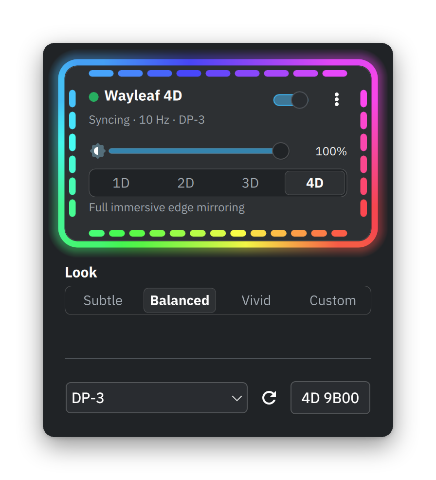

# Wayleaf 4D

Mirror display colors to a Nanoleaf 4D from KDE Plasma. The Wayleaf 4D widget is the primary interface: choose 1D static color, 2D one screen-wide color, 3D ten coarse edge zones, or 4D per-panel edge mirroring. The `wayleaf-4d` CLI remains available for pairing, diagnostics, and standalone streaming.



## Requirements

- KDE Plasma 6 on Wayland and a systemd user manager.
- A Nanoleaf 4D reachable on the local network. Enable API pairing on the controller. Avahi discovery is optional; manual IPv4 entry works.
- Source build: Rust/Cargo 1.89 or newer, GNU Make, and system libcurl/libdrm development files. On Arch or CachyOS:

  ```sh
  yay -S --needed base-devel rust curl libdrm
  ```

  `base-devel` includes Make and pkgconf; `rust` provides Cargo.
- Screen-color modes (2D–4D) also require `/usr/bin/gsr-kms-server` from GPU Screen Recorder 6.1.4. On Arch or CachyOS, install it with:

  ```sh
  yay -S --needed gpu-screen-recorder
  ```

  The capture path also requires compatible DRM/KMS, EGL, OpenGL ES 3, and GBM drivers. 1D static color does not need screen capture or this helper.

## Install and first run

From an existing source checkout:

```sh
make install-user
```

This builds and installs Wayleaf 4D for the current user. It does not install the GSR helper, start the worker, or enable start-at-login. If the legacy `nanoleaf-sync` worker is installed, stop it first; the target refuses to replace an active worker, then disables and removes the old service and binaries. Shared settings and credentials are preserved.

1. In Plasma, use **Add Widgets** to add **Wayleaf 4D** to the panel or System Tray if it is not already visible.
2. In the Nanoleaf app, enable **Settings → Connect to API**, or hold the 4D power button for five seconds. Choose **Find devices**, select the controller, and press **Pair device** within 30 seconds. Or enter its IPv4 address and press **Pair device**; Avahi discovery is optional.
3. Choose **1D** and a static color, or **2D–4D** for screen sampling. Select a monitor in 2D–4D, then press **Start**. Use **Start at login** separately if you want the service enabled for future logins.

## Capture, performance, and privacy

Modes 2D–4D use direct KMS capture through the GSR helper instead of KDE's ScreenCast/portal path. The helper composites supported planes on the GPU and reduces them to a small frame before CPU sampling. No project-specific performance benchmark is published; actual capture and game-frame impact depend on the GPU and driver. The package-managed helper carries `CAP_SYS_ADMIN`; the Wayleaf worker stays unprivileged. Direct KMS shows neither a portal-consent prompt nor KDE's Screen Casting indicator. Start sync only when you intend to send sampled display colors. Captured frames are reduced and sampled in memory; screen images are not saved. Mode 1D does not capture.

## More

- [User Guide](docs/USAGE.md): detailed controls, service behavior, configuration, CLI, diagnostics, and removal.
- [Implementation reference](docs/DEVELOPMENT.md): architecture and implementation details.
- [Release notes](docs/RELEASE_NOTES-0.3.2.md).

## License

Copyright (C) 2026 Avi Tretiak. Wayleaf 4D is licensed under the GNU GPL, version 3 or (at your option) any later version. See [LICENSE](LICENSE). Report issues through the [GitHub issue tracker](https://github.com/avitretiak/wayleaf-4d/issues).
