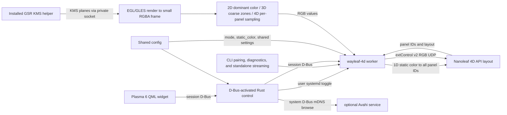

# Implementation reference

## Architecture

The Rust control process never captures. The worker only requests the installed GPU Screen Recorder KMS helper (GSR 6.1.4) in capture modes 2D–4D; 1D sends its configured static color directly to the controller without creating or using screen capture. For capture modes, EGL/OpenGL ES on GBM composes supported planes and reduces them before CPU sampling. The helper has its package-managed `CAP_SYS_ADMIN` capability; the worker and control process remain unprivileged. There is no portal, PipeWire, GStreamer, consent prompt, or KDE Screen Casting indicator. This intentionally trades the portal's per-session consent/visible capture indicator for direct capture: the helper can access scanout without that prompt, so users must turn synchronization on deliberately.

The capture shader converts top-origin KMS source coordinates to the imported texture's Y convention after applying plane rotation. `glReadPixels` rows are then flipped once into top-down RGBA for sampling.

Mode selects the worker's color-to-panel path while preserving discovered controller IDs: 1D sends `static_color` to every panel ID; 2D samples one dominant color from the full display and repeats it for all IDs; 3D samples 10 coarse edge zones (3 top, 2 right, 3 bottom, 2 left) and maps each to the closest matching physical panel zone; 4D retains the full per-panel edge sampling and layout behavior. In 4D, the 34-segment path uses controller `positionData`; the 40-segment NL69 path uses calibrated perimeter geometry and dedicated corner zones; other supported counts use the generic mapping. No corner, offset, or reverse-order remapping is applied.

## Source map

| Path | Responsibility |
|---|---|
| `src/main.rs`, `src/cli.rs` | `wayleaf-4d` CLI dispatch, help/version, pairing, device info, monitor listing, diagnostics, and standalone streaming. |
| `src/config.rs` | Shared XDG config loading, validation, secure atomic saves, defaults, and device credential removal. |
| `src/device.rs` | Nanoleaf LAN API, pairing, device/layout parsing, extControl v2 UDP. |
| `src/kms.rs`, `src/capture.rs`, `src/gpu.rs` | Monitor selection, GSR KMS helper IPC, EGL/GLES/GBM plane composition and reduced RGBA capture. |
| `src/sampling.rs`, `src/runtime.rs` | Edge-zone mapping/color processing, worker D-Bus API, frame scheduling, capture diagnostics. |
| `src/control.rs` | D-Bus-activated control API, settings and service lifecycle, Avahi discovery, pairing/device actions. |
| `share/plasma/io.github.avitretiak.Wayleaf4D/` | Plasma applet metadata and QML UI. |
| `Makefile` | Builds/installs Rust binaries and generates the absolute-path D-Bus activation entry. |
| `share/systemd/user/wayleaf-4d.service` | User worker service managed by the widget toggle. |
| `share/applications/io.github.avitretiak.Wayleaf4D.desktop` | Hidden desktop identity installed with the applet. |
| `docs/USAGE.md` | End-user setup, operation, settings, diagnostics, and removal. |

QML uses Plasma's native asynchronous session-D-Bus interface. The control process owns service and device-management actions; the worker owns capture, sampling, frame scheduling, and UDP streaming. The CLI shares `Config` and can run diagnostics or a standalone stream.

The popup keeps status, the sync switch, mode selector, and brightness visible while showing mode-specific settings. Its live edge preview uses worker-published colors at up to 10 Hz while expanded: one color in 1D and 2D, 10 zones in 3D, and per-panel colors in 4D.

## Dependencies

Build requires Rust and Cargo 1.89 or newer, GNU Make, and development/linker support for system libcurl and libdrm. Cargo resolves the locked Rust dependencies in `Cargo.lock`. No C++ compiler, Qt development packages, or portal/PipeWire/GStreamer capture stack are required.

Runtime capture requires `/usr/bin/gsr-kms-server` from GPU Screen Recorder version 6.1.4 (the package-managed helper carries `CAP_SYS_ADMIN`; Wayleaf does not set or change capabilities and its worker stays unprivileged). It also requires working EGL, OpenGL ES 3, GBM, libdrm, and DRM/GPU drivers supporting the monitor's scanout formats. The implementation dynamically loads `libEGL.so.1`, `libGLESv2.so.2`, and `libgbm.so.1` and links libdrm. No portal consent or Screen Casting indicator is involved. Plasma 6 and a systemd user manager are required for the widget/service controls; system Avahi D-Bus is optional for discovery, with manual IPv4 entry available.

## Configuration and runtime settings

The control process and worker use `$XDG_CONFIG_HOME/nanoleaf-sync/config.json` (normally `~/.config/nanoleaf-sync/config.json`). The QML backend mirrors worker defaults and normalizes setting values; live changes cross session D-Bus. The worker validates updates and merges accepted setting keys into the latest config, preserving controller credentials and unrelated JSON. The shared schema includes `mode` (`1D`, `2D`, `3D`, `4D`) and validated `static_color` (`#RRGGBB`), defaulting to `4D` and `#ffffff`.
