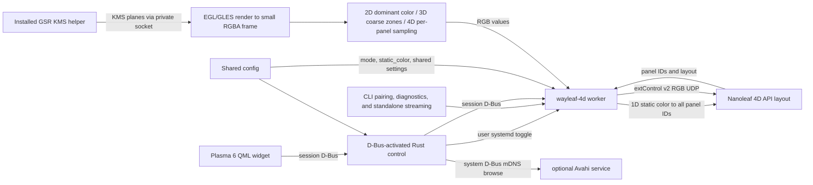

# Implementation reference

## Architecture

The Rust control process never captures. The worker only requests the installed GPU Screen Recorder KMS helper (GSR 6.1.4) in capture modes 2D–4D; 1D sends its configured static color directly to the controller without creating or using screen capture. For capture modes, EGL/OpenGL ES on GBM composes supported planes and reduces them before CPU sampling. The helper has its package-managed `CAP_SYS_ADMIN` capability; the worker and control process remain unprivileged. There is no portal, PipeWire, GStreamer, consent prompt, or KDE Screen Casting indicator. This intentionally trades the portal's per-session consent/visible capture indicator for direct capture: the helper can access scanout without that prompt, so users must turn synchronization on deliberately.

The capture shader converts top-origin KMS source coordinates to the imported texture's Y convention after applying plane rotation. `glReadPixels` rows are then flipped once into top-down RGBA for sampling.

The worker assigns colors to discovered controller IDs according to the selected mode; sampling behavior and panel-layout geometry are detailed in [Sampling and panel layouts](#sampling-and-panel-layouts).

## Source map

| Path | Responsibility |
|---|---|
| `src/main.rs`, `src/cli.rs` | `wayleaf-4d` CLI dispatch, help/version, pairing, device info, monitor listing, diagnostics, and standalone streaming. |
| `src/config.rs` | Shared XDG config loading, validation, secure atomic saves, defaults, and device credential removal. |
| `src/device.rs` | Nanoleaf LAN API, pairing, device/layout parsing, extControl v2 UDP. |
| `src/kms.rs`, `src/capture.rs`, `src/gpu.rs` | Monitor selection, GSR KMS helper IPC, EGL/GLES/GBM plane composition and reduced RGBA capture. |
| `src/sampling.rs`, `src/runtime.rs` | Edge-zone mapping/color processing, worker D-Bus API, frame scheduling, capture diagnostics. |
| `src/control.rs` | D-Bus-activated control API, settings and service lifecycle, Avahi discovery, pairing/device actions. |
| `share/plasma/io.github.avitretiak.Wayleaf4D/` | Plasma applet metadata and QML UI. |
| `Makefile` | Builds/installs Rust binaries, checks packaged shader freshness, and generates the absolute-path D-Bus activation entry. |
| `share/systemd/user/wayleaf-4d.service` | User worker service managed by the widget toggle. |
| `share/applications/io.github.avitretiak.Wayleaf4D.desktop` | Hidden desktop identity installed with the applet. |
| `README.md` | User-facing overview, requirements, source installation, and first run. |
| `docs/USAGE.md` | Detailed controls, service behavior, configuration, CLI, diagnostics, and removal. |

QML uses Plasma's native asynchronous session-D-Bus interface. The control process owns service and device-management actions; the worker owns capture, sampling, frame scheduling, and UDP streaming. The CLI shares `Config` and can run diagnostics or a standalone stream.

The popup uses a 280×160 logical-pixel hero card, scaled by `Kirigami.Units.gridUnit / 16`, with a 20 px popup margin. Equal-length 6 px segment pills with 4 px gaps sit inside its edges; 4D pills preserve controller IDs and counts, with a 9/6/13/6 top/right/bottom/left fallback when live geometry is unavailable. `GlowRing.qml` interpolates the same sorted zone arrays into a 256×4 color texture; a rounded-rectangle distance shader draws only outside the card, at 95% alpha through 6 px and fading to zero at 16 px. Vertical preview positions are top-down. Zone spans are retained but do not change equal-length pill geometry. Both previews use 30% opacity when stopped; without live colors, 1D uses its static color and other modes use the disabled-text theme color. Colors update directly without animation, including when `longDuration` is zero. Preview publication remains limited to 10 Hz while expanded and running in 2D–4D; closing the popup disables preview requests without stopping output.

Corner colors interpolate by angle around the rounded turn, rather than inverse distances to the straight edge lines; the latter reverse outside the card and produce pinched color wedges. Kirigami's `PlatformTheme` has no `separatorColor` role, so the card derives its separator from the theme text color at 20% opacity.

## Build and capture internals

User-facing prerequisites and source-install steps are in the [README](../README.md). The Makefile builds with the checked-in `Cargo.lock`; the worker links system libcurl and libdrm and dynamically loads `libEGL.so.1`, `libGLESv2.so.2`, and `libgbm.so.1`. No C++ or Qt toolchain is required for the normal worker build; precompiled `.qsb` shader packages are committed, so normal builds only check their freshness.

When editing `glow_ring.vert` or `glow_ring.frag`, regenerate both packages with `make shaders` using `/usr/lib/qt6/bin/qsb --qt6` from Qt 6 Shader Tools. `make` and `make install-user` fail with regeneration guidance if either package is missing or older than its source.

`make install-user` installs the worker, applet, user service, desktop identity, and D-Bus activation entry under user directories, then reloads systemd and D-Bus. It does not start or enable Wayleaf. It refuses to proceed while the legacy `nanoleaf-sync` worker or service is active; otherwise it disables and removes that legacy service and binaries while preserving the shared configuration. The Wayleaf binary is replaced atomically, so an already-running worker continues with its loaded code. Absolute `XDG_DATA_HOME` and `XDG_CONFIG_HOME` overrides are honored; unset or relative values use the standard home-directory defaults.

## Sampling and panel layouts

Mode determines how sampled or static colors are assigned while controller panel IDs remain intact:

- **1D** uses `static_color` directly and sends that color to every discovered panel ID. It does not start screen capture.
- **2D** samples one dominant color from the entire selected display and repeats it for every panel ID.
- **3D** samples 10 coarse zones around the screen (3 top, 2 right, 3 bottom, 2 left); each zone color is assigned to the closest matching physical panel zone.
- **4D** preserves the full per-panel behavior: each controller segment samples its corresponding screen-edge region. Captured frames are downscaled to at most 320 pixels wide; edge depth controls how far inward each region reaches, and letterbox detection optionally limits sampling to the active picture.

For 4D with 34 segments, mapping uses the controller's `positionData` coordinates and preserves each panel ID. The 40-segment NL69 layout uses calibrated perimeter geometry with dedicated corner zones 1.5 times the edge depth. Other reported counts from 4 through 40 use the generic perimeter mapping. There is no corner, offset, or reverse-order remapping; the count reported by the controller determines the number of LEDs sent.

4D zones use saturation-weighted averaging blended with their brightest-luma pixel. Feathering tapers weights inward; center blend optionally mixes the average RGB of the central half of the active picture (sampled every fourth pixel) into each zone. Black gating and brightness/color controls follow these mixes; smoothing and maximum step bound temporal changes. Controls that do not apply in the selected mode are hidden in the applet, but their saved values are retained.

## Configuration and runtime settings

The control process and worker use `$XDG_CONFIG_HOME/nanoleaf-sync/config.json` (normally `~/.config/nanoleaf-sync/config.json`). The QML backend mirrors worker defaults and normalizes setting values; live changes cross session D-Bus. The worker validates updates and merges accepted setting keys into the latest config, preserving controller credentials and unrelated JSON. The shared schema includes `mode` (`1D`, `2D`, `3D`, `4D`) and validated `static_color` (`#RRGGBB`), defaulting to `4D` and `#ffffff`.
