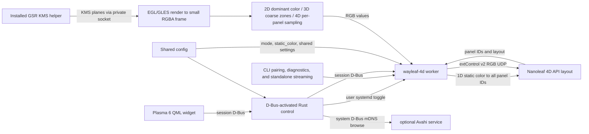

# Implementation reference

## Architecture



The control process handles settings and device management without capturing the screen. In modes 2D–4D, the worker requests the installed GPU Screen Recorder KMS helper (GSR 6.1.4); EGL/OpenGL ES on GBM composes supported planes and reduces them before CPU sampling. Mode 1D sends its configured static color without screen capture. Only the package-managed helper carries `CAP_SYS_ADMIN`; the worker and control process remain unprivileged. Direct KMS capture does not request portal consent or display KDE's Screen Casting indicator, so synchronization must be enabled deliberately.

DRM enumeration selects only connected connectors with an active CRTC. If the configured monitor is absent, KMS returns no primary plane, or the helper temporarily returns an empty successful response, the worker reports a temporary capture failure (exit status 75); the user service retries after 15 seconds. This lets display/KMS recovery resume sync without a widget toggle. Invalid or ambiguous monitor selections and protocol incompatibilities remain permanent startup errors.

The capture shader converts top-origin KMS source coordinates to the imported texture's Y convention after applying plane rotation. `glReadPixels` rows are then flipped once into top-down RGBA for sampling.

The worker assigns colors to discovered controller IDs according to the selected mode; sampling behavior and panel-layout geometry are detailed in [Sampling and panel layouts](#sampling-and-panel-layouts).

## Source map

| Path | Responsibility |
|---|---|
| `src/main.rs`, `src/cli.rs` | `wayleaf-4d` CLI dispatch, help/version, pairing, device info, monitor listing, diagnostics, and standalone streaming. |
| `src/config.rs` | Shared XDG config loading, validation, secure atomic saves, defaults, and device credential removal. |
| `src/device.rs` | Nanoleaf LAN API, pairing, device/layout parsing, extControl v2 UDP. |
| `src/kms.rs`, `src/capture.rs`, `src/gpu.rs` | Monitor selection, GSR KMS helper IPC, EGL/GLES/GBM plane composition and reduced RGBA capture. |
| `src/sampling.rs`, `src/runtime.rs` | Edge-zone mapping/color processing, worker D-Bus API, frame scheduling, capture diagnostics. |
| `src/control.rs` | D-Bus-activated control API, settings and service lifecycle, Avahi discovery, pairing/device actions. |
| `share/plasma/io.github.avitretiak.Wayleaf4D/` | Plasma applet metadata and QML UI. |
| `Makefile` | Builds/installs Rust binaries, checks packaged shader freshness, and generates the absolute-path D-Bus activation entry. |
| `share/systemd/user/wayleaf-4d.service` | User worker service managed by the widget toggle. |
| `share/applications/io.github.avitretiak.Wayleaf4D.desktop` | Hidden desktop identity installed with the applet. |
| `README.md` | User-facing overview, requirements, source installation, and first run. |
| `docs/USAGE.md` | Detailed controls, service behavior, configuration, CLI, diagnostics, and removal. |

QML uses Plasma's native asynchronous session-D-Bus interface. The control process owns service and device-management actions; the worker owns capture, sampling, frame scheduling, and UDP streaming. The CLI shares `Config` and can run diagnostics or a standalone stream.

The popup's hero card is 280×160 logical pixels with a 20 px outer margin, scaled by `Kirigami.Units.gridUnit / 16`. Equal-length 6 px segment pills have 4 px gaps and a 4 px inset. Live 4D pills use controller IDs and counts; without layout data, the placeholder has 9 top, 6 right, 13 bottom, and 6 left segments. Vertical positions are top-down; zone spans do not change pill lengths.

`GlowRing.qml` interpolates the sorted zone arrays into a 256×4 color texture. A rounded-rectangle distance shader draws an antialiased 6 px rim outside the card and a Gaussian-profile halo extending to 16 px. The halo uses a five-tap color kernel with a 4.5 px spread; the rim and pills use their zone colors.

Stopped previews use 30% opacity. Without live colors, 1D uses its static color and other modes use the theme's disabled-text color. Colors update without animation. Preview requests run only while the popup is open and stop without stopping synchronization.

Corner colors interpolate by angle around the rounded turn. The hero separator uses the theme text color at 20% opacity.

`SteppedSlider.qml` is the shared native Qt Quick Controls `Slider` used for mode and Look selection: values 0–3, unit steps, and `SnapAlways`, with a quarter-width selection pill and four labels. Clicks, dragging, keyboard arrows, and external value changes share the same binding. `FullRepresentation.qml` receives the backend and applet configuration explicitly from `main.qml`; it saves current Custom settings before applying a preset and persists Custom's selection identity separately. Preset matching uses displayed slider steps rather than exact `f32` equality. Only Custom exposes directly visible fine tuning; controls follow mode relevance (2D exposes maximum step; 3D adds edge depth, brightest-pixel blend, black threshold, and spatial gradient; 4D adds letterbox, strict black, and spatial gradient). Reset buttons affect only the visible settings in their group.


## Defaults and setting names

New installations and Balanced use brightness **1.0**, Color enhancement (`saturation_boost`) **1.0**, Transition speed (`smooth`) **0.25**, and Dark-scene cutoff (`black_threshold`) **0.05**. Brightness is global across modes, independent of Looks, and is not changed by Look or fine-tuning resets; on the existing 0–2 control scale, 1.0 is displayed at 50%. Resetting fine-tuning restores Balanced's Look-controlled values while retaining Custom selection. The cutoff is not a new lower bound: saved lower values remain valid and are preserved. Subtle and Vivid retain their **0.01** cutoff; Highlight influence (`peak_mix`) remains **10%** and Neighbor blending (`spatial_blend`) remains off at the default 20% blend strength.

Setting labels map to the existing persisted keys: Brightness `brightness`; Color enhancement `saturation_boost`; Transition speed `smooth`; Max change per update `max_step`; Dark-scene cutoff `black_threshold`; Edge sample depth `edge_depth`; Edge feathering `feather_depth`; Center influence `center_bleed`; Highlight influence `peak_mix`; Neighbor blending `spatial_blend`; Midtone lift `midtone_lift`; Ignore black bars `letterbox`; Immediate black `strict_black`; Update rate `fps`. These are UI vocabulary changes, not schema/key renames. The 0.05 cutoff default was selected after a user report of red/yellow flicker on gray with a lower cutoff; it is not a universal calibration or guarantee against flicker.
## Build and capture internals

User-facing prerequisites and source-install steps are in the [README](../README.md). The Makefile builds with the checked-in `Cargo.lock`; the worker links system libcurl and libdrm and dynamically loads `libEGL.so.1`, `libGLESv2.so.2`, and `libgbm.so.1`. No C++ or Qt toolchain is required for the normal worker build; precompiled `.qsb` shader packages are committed, so normal builds only check their freshness.

When editing `glow_ring.vert` or `glow_ring.frag`, regenerate both packages with `make shaders` using `/usr/lib/qt6/bin/qsb --qt6` from Qt 6 Shader Tools. `make` and `make install-user` fail with regeneration guidance if either package is missing or older than its source.

`make install-user` installs the worker, applet, user service, desktop identity, and D-Bus activation entry under user directories, then reloads systemd and D-Bus. It does not start or enable Wayleaf. It refuses to proceed while the legacy `nanoleaf-sync` worker or service is active; otherwise it disables and removes that legacy service and binaries while preserving the shared configuration. The Wayleaf binary is replaced atomically, so an already-running worker continues with its loaded code. Absolute `XDG_DATA_HOME` and `XDG_CONFIG_HOME` overrides are honored; unset or relative values use the standard home-directory defaults.

The tray renders the bundled `contents/ambient-light.svg` directly. Plasma metadata uses the application-ID icon name; installers register the artwork under `$USER_SHARE/pixmaps` or `/usr/share/pixmaps`, which KDE searches as an unthemed fallback after the selected icon theme.

Device URLs use local HTTP, and curl is built without its default TLS feature. Signal-hook provides signal flags without channel/iterator features. Zbus uses its default runtime and blocking API features.

## Verification

Run Rust unit tests, build the worker, and run its module self-tests:

```sh
cargo test --locked --target-dir build/cargo
make
build/wayleaf-4d --self-test
```

The QML regressions use isolated in-memory backend/configuration objects; they do not connect to the worker or change the lights. With Qt 6 Declarative's `qmltestrunner`, Kirigami, and the KDE desktop control style installed:

```sh
QT_QPA_PLATFORM=offscreen QT_QUICK_BACKEND=software \
QT_QUICK_CONTROLS_STYLE=org.kde.desktop QT_STYLE_OVERRIDE=Breeze \
```

These checks cover Look clicks/dragging/keyboard input, Custom-to-preset round-trips, popup recreation, `f32` preset matching, Custom-only fine-tune visibility, and alignment independence from presets/custom-look persistence. Alignment controls are exercised with keyboard input and their group reset. Balanced is the new-install default; reset-all restores Balanced values while retaining Custom selection. Color enhancement is 1.0 for Subtle and Balanced, and 1.9 for Vivid; Balanced and new-install/reset dark-scene cutoff is 0.05, while Subtle and Vivid remain 0.01. Brightness defaults to 1.0 independently of Looks and fine-tune resets. Saved legacy preset selections retain their old values unless reset. Software rendering is sufficient for state/input tests; shader appearance can be checked separately in a native Plasma/Qt Quick window.


## Sampling and panel layouts

Mode determines how sampled or static colors are assigned while controller panel IDs remain intact:

- **1D** uses `static_color` directly and sends that color to every discovered panel ID. It does not start screen capture.
- **2D** samples one dominant color from the entire selected display and repeats it for every panel ID.
- **3D** samples 10 coarse zones around the screen (3 top, 2 right, 3 bottom, 2 left); each zone color is assigned to the closest matching physical panel zone. Preview publication preserves that explicit edge ownership even when a side zone touches a top or bottom corner; nearest-border ties must not reclassify it.
- **4D** samples one screen-edge region per controller segment. Captured frames are downscaled to at most 320 pixels wide; edge depth controls how far inward each region reaches, and letterbox detection optionally limits sampling to the active picture.

`panelLayout/layout.numPanels` must match the length of `positionData`. Supported layouts contain 1–40 panels; zero panels, counts over 40, malformed entries, and duplicate IDs are rejected. The output contains exactly the reported panels. API coordinates use x rightwards and y upwards; sampling rectangles use normalized screen coordinates with x rightwards and y downwards. Panel IDs are opaque output addresses, not array indices.

The `positionData` sequence supplies traversal order. Coordinate changes determine horizontal or vertical runs and their nearest physical side. Corners belong to the incoming run; the first panel uses its outgoing step. Tangent-coordinate midpoints and extrapolated endpoint bounds determine sampling intervals. Separate runs on one edge occupy adjacent spans weighted by their coordinate extents, including when those runs contain overlapping reported coordinates. `Zone.edge` records physical side ownership for preview publication.

The calibrated 40-panel NL69 layout uses dedicated sampling rectangles, including corners 1.5 times the edge depth, when its ordered live coordinates match the reference. Other layouts use their reported geometry. Worker startup fetches the layout; setting changes rebuild zones from that worker's cached panels. A physical count or layout change requires a worker restart.

Alignment settings are `start_corner`, `reverse_direction`, and `perimeter_offset`. Default `bottom_center` selects anchor index zero and leaves the reported ID assignment unchanged. Other anchors use live corner positions; calibrated 40-panel anchors are 7, 15, 28, and 35. For rectangle index `i`, the output ID is `panels[(anchor + offset + direction*i).rem_euclid(n)].id`, where direction is +1 normally and −1 when reversed. Geometry and edge ownership stay fixed. Offsets validate in −39…39 and reduce modulo the current count when mapping. Alignment is independent of Look presets and saved Custom values. Legacy key migration and configuration compatibility rules are documented in the [User Guide](USAGE.md#configuration-and-security).

`GetPanelCount` is read-only on both worker and control D-Bus interfaces. The control method forwards the worker's cached startup count, or zero when unavailable; it is not a persisted setting and cannot be set through `SetSettings`. QML polls it independently of the mode-specific preview count.

All sampled modes (2D–4D) retain encoded-RGB saturation-weighted averaging and their mode-specific brightest-pixel mix. Weighting and final saturation enhancement taper below 0.15 normalized, Rec.709-weighted encoded luma; this is not linear-light luminance. Feathering tapers weights inward; center blend optionally mixes the central picture average. Black gating applies in 3D–4D (2D disables it), followed by the existing saturation, optional lift, brightness, and clipping stages. Balanced and new-install/reset defaults use 10% brightest-pixel blend; explicitly saved values and Custom data are preserved.

Spatial gradient processing is an optional fixed 20% encoded-RGB geometry blend for 3D–4D, controlled by persisted boolean `spatial_blend` (default false). Cached geometry weights use radius 0.35 and falloff `max(1 - distance/0.35, 0)^2`, excluding each receiver itself. Exact-black receivers are left unchanged; black neighboring samples still contribute and can darken lit zones. Every frame reads an immutable floating-point snapshot and writes blended values without temporal feedback, then quantizes; cached remapping avoids frame allocations. The setting is independent of Look and alignment; 1D–2D hide it without clearing the saved value.

Temporal response retains `alpha = 1 - (1 - smooth)^(elapsed * 30)` and `step = max_step * elapsed * 30`, but scales the complete RGB delta by `min(1, step / max(abs(delta)))`. Ordinary intervals use actual elapsed time. A gap greater than `max(2 / fps, 0.5)` seconds uses at most 100 ms for its first resumed update; it neither resets output through black nor causes catch-up sends. Scene cuts remain diagnostic and do not bypass response limiting.

Per-zone state confirms near-black input for 150 ms, holds the preceding float output during confirmation, and retains confirmed black until input exceeds 1.25 times the existing threshold. Threshold zero bypasses this threshold hysteresis. Confirmed black fades proportionally from its starting RGB over `max(0.3, max_rgb / (max_step * 30))` seconds, reaching exact zero; a lower live Max change per update rebases the fade without brightening it. Immediate black immediately clears output and fade state. Nonblack input can interrupt a fade. Float response state is not quantized. The ordinary smoother snaps to its target only within four scale-adjusted `f32` epsilons and the current step ceiling, avoiding permanent rounding-boundary residuals without bypassing meaningful smoothing. Changed zone IDs, geometry, or count reset the per-zone state.

Packet quantization uses the largest clamped float RGB component as a shared intensity anchor. Its byte retains the preceding packet's maximum while within ±0.75 code, except that exact endpoints update immediately. Each channel's nonnegative difference from the current float maximum is rounded afresh and subtracted from the anchor byte, with saturating subtraction; exact zero and 255 components are preserved. Ordinary transitions retain only intensity history, so prior chroma cannot remain latched. Differences smaller than half a code do not become one-code color flashes in otherwise near-neutral output. The ordinary quantizer's anchor error is at most 0.75 code and its per-channel error is at most 1.25 codes, trading a larger absolute RGB error bound for directly quantized color differences. During confirmed-black fades, encoded channels are additionally capped at their preceding packet values so rounding cannot cause a one-code brightening, including after lowering Max change per update or with Neighbor blending enabled. This fade-only cap does not feed packet values back into float temporal state; exact black remains reachable.

`src/sampling/letterbox.rs` owns the private crop detector. It samples border occupancy (encoded luma at most 12/255 for at least 82% of sampled pixels) and contrasting interior evidence (at least 10% at or above 24/255). Symmetric borders produce candidates; credible bright edges can restore the full frame. Candidates require at least two observations and 500 ms of consistent evidence. Ambiguous frames retain the known crop rather than inventing a centered picture in uniform darkness. Disabling detection or changing capture dimensions resets crop state. Neither crop detection nor temporal processing changes physical panel IDs or mapping geometry.

## Configuration and runtime settings

The control process and worker use `$XDG_CONFIG_HOME/nanoleaf-sync/config.json` (normally `~/.config/nanoleaf-sync/config.json`). The QML backend mirrors worker defaults and normalizes setting values; live changes cross session D-Bus. The worker validates updates and merges accepted setting keys into the latest config, preserving controller credentials and unrelated JSON. The shared schema includes `mode` (`1D`, `2D`, `3D`, `4D`) and validated `static_color` (`#RRGGBB`), defaulting to `4D` and `#ffffff`. Alignment uses the canonical `start_corner`, `reverse_direction`, and `perimeter_offset` keys; the read-only detected panel count is fetched from the worker and is not persisted.
