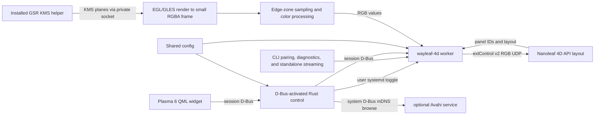

# Development

## Architecture



The Rust control process never captures. The worker uses the installed GPU Screen Recorder KMS helper (GSR 6.1.4) for direct KMS scanout; EGL/OpenGL ES on GBM composes supported planes and reduces them before CPU sampling. The helper has its package-managed `CAP_SYS_ADMIN` capability; the worker and control process remain unprivileged. There is no portal, PipeWire, GStreamer, consent prompt, or KDE Screen Casting indicator. This intentionally trades the portal's per-session consent/visible capture indicator for direct capture: the helper can access scanout without that prompt, so users must turn synchronization on deliberately.

The capture shader converts top-origin KMS source coordinates to the imported texture's Y convention after applying plane rotation. `glReadPixels` rows are then flipped once into top-down RGBA for sampling.

The worker discovers panel IDs and layout from the controller. The 34-segment path uses the controller's `positionData`; the 40-segment NL69 path uses calibrated perimeter geometry and dedicated corner zones; other supported counts use the generic mapping. It preserves controller panel IDs without applying a corner, offset, or reverse-order remapping.

## Source map

| Path | Responsibility |
|---|---|
| `src/main.rs`, `src/cli.rs` | `wayleaf-4d` CLI dispatch, help/version, pairing, device info, monitor listing, diagnostics, and standalone streaming. |
| `src/config.rs` | Shared XDG config loading, validation, secure atomic saves, defaults, and device credential removal. |
| `src/device.rs` | Nanoleaf LAN API, pairing, device/layout parsing, extControl v2 UDP. |
| `src/kms.rs`, `src/capture.rs`, `src/gpu.rs` | Monitor selection, GSR KMS helper IPC, EGL/GLES/GBM plane composition and reduced RGBA capture. |
| `src/sampling.rs`, `src/runtime.rs` | Edge-zone mapping/color processing, worker D-Bus API, frame scheduling, capture diagnostics. |
| `src/control.rs` | D-Bus-activated control API, settings and service lifecycle, Avahi discovery, pairing/device actions. |
| `share/plasma/io.github.avitretiak.Wayleaf4D/` | Plasma applet metadata and QML UI. |
| `Makefile` | Builds/installs Rust binaries and generates the absolute-path D-Bus activation entry. |
| `share/systemd/user/wayleaf-4d.service` | User worker service managed by the widget toggle. |
| `share/applications/io.github.avitretiak.Wayleaf4D.desktop` | Hidden desktop identity installed with the applet. |
| `docs/USAGE.md` | End-user setup, operation, settings, diagnostics, and removal. |

QML uses Plasma's native asynchronous session-D-Bus interface; there is no C++/Qt plugin build. `make` builds the Rust binary as `build/wayleaf-4d`. `make install-user` installs it with the QML applet, D-Bus activation file, and worker unit. A Plasma reload may be needed after QML changes; this is separate from the worker and does not require restarting `wayleaf-4d.service`.

The Plasma `DBusMessage` constructor takes `interface` in its map, even though its QML property is named `iface`.

## Build and runtime dependencies

Build requires Rust 2021 support, Rust 1.89 or newer (`rustc` and Cargo), GNU Make, and development/linker support for system libcurl and libdrm. Cargo resolves the locked Rust dependencies in `Cargo.lock`; the locked `uuid` dependency requires Rust 1.89. No C++ compiler, Qt development packages, or portal/PipeWire/GStreamer capture stack are needed to build this project.

Runtime capture requires `/usr/bin/gsr-kms-server` from GPU Screen Recorder version 6.1.4 (the package-managed helper carries `CAP_SYS_ADMIN`; Wayleaf does not set or change capabilities and its worker stays unprivileged). It also requires working EGL, OpenGL ES 3, GBM, libdrm, and DRM/GPU drivers supporting the monitor's scanout formats. The implementation dynamically loads `libEGL.so.1`, `libGLESv2.so.2`, and `libgbm.so.1` and links libdrm. No portal consent or Screen Casting indicator is involved. Plasma 6 and a systemd user manager are required for the widget/service controls; system Avahi D-Bus is optional for discovery, with manual IPv4 entry available.

## Build and install

```sh
make
make install-user
```

`make` builds the Rust worker under `build/` using Cargo's locked release build. `make install-user` installs under `XDG_DATA_HOME` (default `~/.local/share`) and the user service under `XDG_CONFIG_HOME/systemd/user/` (default `~/.config/systemd/user/`), registers/reloads D-Bus activation, and runs `systemctl --user daemon-reload`. Absolute XDG overrides are honored; relative values use the standard defaults. Installation refuses to continue while the legacy `nanoleaf-sync.service` or CLI worker is active; it never stops an active stream. It disables/removes only the inactive legacy service and binaries, does not enable, start, stop, or restart Wayleaf 4D, and does not overwrite Nanoleaf config. `make clean` removes `build/`.

Installing a new binary atomically replaces the executable and does not start, stop, or restart the worker or control service. A running worker and any already-activated control process keep using their old loaded code; the new worker binary takes effect on its next start, and updated QML requires a Plasma reload. This lets installation complete without interrupting a live stream, but does not fully activate the update. When you choose to switch versions, press **Stop** first (it best-effort powers off the Nanoleaf), then restart the old control process while no pairing/device operation is active: inspect its PID with `busctl --user status io.github.avitretiak.Wayleaf4D.Control`, send `TERM` to that PID, and let the next widget request activate the installed binary. Reload QML after the install; log out and back in, or restart the Plasma shell on sessions providing `plasma-plasmashell.service`:

```sh
systemctl --user restart plasma-plasmashell.service
```

This restarts the desktop shell, not `wayleaf-4d.service`. Do not restart the worker, control process, or shell while uninterrupted streaming is required; defer activation until a user-chosen Stop window.

## Verification

Verification commands (run only when authorized; building may update `build/`):

```sh
make
./build/wayleaf-4d --self-test
./build/wayleaf-4d --help
./build/wayleaf-4d --version
./build/wayleaf-4d --list-monitors
```

`--self-test` runs local module checks, including configuration, argument bounds, sampling, layout mapping, KMS protocol validation, and capture transforms; it does not require the helper or contact a controller. `--capture-test --monitor NAME` exercises actual capture without controller credentials or UDP streaming, reports dimensions, frame count, and timing, and saves no images. `--capture-debug --monitor NAME` also requires saved controller credentials; for ten seconds it prints timing and per-zone target/output RGB values without sending UDP frames or saving images/settings. Sampled RGB can reveal screen content, so review diagnostic output before sharing. These capture modes use direct KMS and have no portal selection/restore token.

Before publishing a release, verify a Plasma 6 session, helper/GPU capture, and real Nanoleaf streaming. Do not infer display/game performance from synthetic or diagnostic runs.

## Shared-setting contract

The worker `Config`, the QML backend defaults and normalizer, the visible controls, and the settings table in `docs/USAGE.md` describe one shared JSON schema. When changing a setting, update all of them together and keep ranges/defaults aligned. Live changes cross the session D-Bus interface; the worker merges accepted setting keys into the latest config file rather than replacing controller credentials or unrelated settings.
