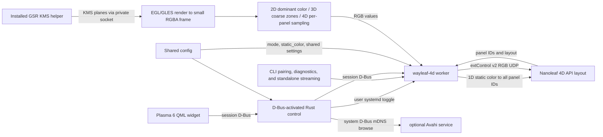

# Implementation reference

## Architecture



The Rust control process never captures. The worker only requests the installed GPU Screen Recorder KMS helper (GSR 6.1.4) in capture modes 2D–4D; 1D sends its configured static color directly to the controller without creating or using screen capture. For capture modes, EGL/OpenGL ES on GBM composes supported planes and reduces them before CPU sampling. The helper has its package-managed `CAP_SYS_ADMIN` capability; the worker and control process remain unprivileged. There is no portal, PipeWire, GStreamer, consent prompt, or KDE Screen Casting indicator. This intentionally trades the portal's per-session consent/visible capture indicator for direct capture: the helper can access scanout without that prompt, so users must turn synchronization on deliberately.

The capture shader converts top-origin KMS source coordinates to the imported texture's Y convention after applying plane rotation. `glReadPixels` rows are then flipped once into top-down RGBA for sampling.

The worker assigns colors to discovered controller IDs according to the selected mode; sampling behavior and panel-layout geometry are detailed in [Sampling and panel layouts](#sampling-and-panel-layouts).

## Source map

| Path | Responsibility |
|---|---|
| `src/main.rs`, `src/cli.rs` | `wayleaf-4d` CLI dispatch, help/version, pairing, device info, monitor listing, diagnostics, and standalone streaming. |
| `src/config.rs` | Shared XDG config loading, validation, secure atomic saves, defaults, and device credential removal. |
| `src/device.rs` | Nanoleaf LAN API, pairing, device/layout parsing, extControl v2 UDP. |
| `src/kms.rs`, `src/capture.rs`, `src/gpu.rs` | Monitor selection, GSR KMS helper IPC, EGL/GLES/GBM plane composition and reduced RGBA capture. |
| `src/sampling.rs`, `src/runtime.rs` | Edge-zone mapping/color processing, worker D-Bus API, frame scheduling, capture diagnostics. |
| `src/control.rs` | D-Bus-activated control API, settings and service lifecycle, Avahi discovery, pairing/device actions. |
| `share/plasma/io.github.avitretiak.Wayleaf4D/` | Plasma applet metadata and QML UI. |
| `Makefile` | Builds/installs Rust binaries, checks packaged shader freshness, and generates the absolute-path D-Bus activation entry. |
| `share/systemd/user/wayleaf-4d.service` | User worker service managed by the widget toggle. |
| `share/applications/io.github.avitretiak.Wayleaf4D.desktop` | Hidden desktop identity installed with the applet. |
| `README.md` | User-facing overview, requirements, source installation, and first run. |
| `docs/USAGE.md` | Detailed controls, service behavior, configuration, CLI, diagnostics, and removal. |

QML uses Plasma's native asynchronous session-D-Bus interface. The control process owns service and device-management actions; the worker owns capture, sampling, frame scheduling, and UDP streaming. The CLI shares `Config` and can run diagnostics or a standalone stream.

The popup uses a 280×160 logical-pixel hero card, scaled by `Kirigami.Units.gridUnit / 16`, with a 20 px popup margin. Equal-length 6 px segment pills with 4 px gaps sit inside its edges; 4D pills preserve controller IDs and counts, with a 9/6/13/6 top/right/bottom/left fallback when live geometry is unavailable. `GlowRing.qml` interpolates the same sorted zone arrays into a 256×4 color texture; a rounded-rectangle distance shader draws only outside the card, combining a 6 px bright rim with a lighter Gaussian-profile halo that reaches zero at 16 px. Screen-space derivatives antialias both rim boundaries, and the card background explicitly enables antialiasing. The halo uses a five-tap Gaussian color kernel with a 4.5 px spread; the rim and pills retain their original zone colors. Vertical preview positions are top-down. Zone spans are retained but do not change equal-length pill geometry. Both previews use 30% opacity when stopped; without live colors, 1D uses its static color and other modes use the disabled-text theme color. Colors update directly without animation, including when `longDuration` is zero. Preview publication remains limited to 10 Hz while expanded and running in 2D–4D; closing the popup disables preview requests without stopping output.

Corner colors interpolate by angle around the rounded turn, rather than inverse distances to the straight edge lines; the latter reverse outside the card and produce pinched color wedges. Kirigami's `PlatformTheme` has no `separatorColor` role, so the card derives its separator from the theme text color at 20% opacity.

Pills are inset 4 logical pixels from the card border, leaving a small gap to the exterior rim without moving the controls.

`SteppedSlider.qml` is the shared native Qt Quick Controls `Slider` used for mode and Look selection: values 0–3, unit steps, and `SnapAlways`, with a quarter-width selection pill and four labels. Clicks, dragging, keyboard arrows, and external value changes share the same binding. `FullRepresentation.qml` receives the backend and applet configuration explicitly from `main.qml`; it saves the current custom settings before applying a preset and persists Custom's selection identity separately. Preset matching uses displayed slider steps rather than exact `f32` equality. Only Custom exposes fine tuning, and resetting it does not switch the Look back to Balanced.

## Build and capture internals

User-facing prerequisites and source-install steps are in the [README](../README.md). The Makefile builds with the checked-in `Cargo.lock`; the worker links system libcurl and libdrm and dynamically loads `libEGL.so.1`, `libGLESv2.so.2`, and `libgbm.so.1`. No C++ or Qt toolchain is required for the normal worker build; precompiled `.qsb` shader packages are committed, so normal builds only check their freshness.

When editing `glow_ring.vert` or `glow_ring.frag`, regenerate both packages with `make shaders` using `/usr/lib/qt6/bin/qsb --qt6` from Qt 6 Shader Tools. `make` and `make install-user` fail with regeneration guidance if either package is missing or older than its source.

`make install-user` installs the worker, applet, user service, desktop identity, and D-Bus activation entry under user directories, then reloads systemd and D-Bus. It does not start or enable Wayleaf. It refuses to proceed while the legacy `nanoleaf-sync` worker or service is active; otherwise it disables and removes that legacy service and binaries while preserving the shared configuration. The Wayleaf binary is replaced atomically, so an already-running worker continues with its loaded code. Absolute `XDG_DATA_HOME` and `XDG_CONFIG_HOME` overrides are honored; unset or relative values use the standard home-directory defaults.

The tray renders the bundled `contents/ambient-light.svg` directly. Plasma metadata retains the application-ID icon name; installers register the same artwork under `$USER_SHARE/pixmaps` or `/usr/share/pixmaps`, which KDE searches as an unthemed fallback after the selected icon theme. This needs no direct `hicolor-icon-theme` dependency. User installation removes the previous user-local hicolor copy; package upgrades remove the old package-owned copy.

Cargo disables curl's default TLS feature because device URLs are constructed as HTTP, and disables signal-hook's unused channel/iterator features. This removes `openssl-probe` and `openssl-sys` from the Rust graph, not OpenSSL from the system libcurl dependency. Zbus retains its default runtime and blocking API features.

## Verification

Build the worker and exercise its module self-tests:

```sh
make
build/wayleaf-4d --self-test
```

The QML regressions use isolated in-memory backend/configuration objects; they do not connect to the worker or change the lights. With Qt 6 Declarative's `qmltestrunner`, Kirigami, and the KDE desktop control style installed:

```sh
QT_QPA_PLATFORM=offscreen QT_QUICK_BACKEND=software \
QT_QUICK_CONTROLS_STYLE=org.kde.desktop QT_STYLE_OVERRIDE=Breeze \
/usr/lib/qt6/bin/qmltestrunner -input tests/qml
```

These checks cover Look clicks/dragging/keyboard input, Custom-to-preset round-trips, popup recreation, `f32` preset matching, Custom-only fine-tune visibility, and alignment independence from presets/custom-look persistence. Alignment controls are exercised with keyboard input and their group reset. Software rendering is sufficient for state/input tests; verify shader appearance separately in a native Plasma/Qt Quick window.


## Sampling and panel layouts

Mode determines how sampled or static colors are assigned while controller panel IDs remain intact:

- **1D** uses `static_color` directly and sends that color to every discovered panel ID. It does not start screen capture.
- **2D** samples one dominant color from the entire selected display and repeats it for every panel ID.
- **3D** samples 10 coarse zones around the screen (3 top, 2 right, 3 bottom, 2 left); each zone color is assigned to the closest matching physical panel zone. Preview publication preserves that explicit edge ownership even when a side zone touches a top or bottom corner; nearest-border ties must not reclassify it.
- **4D** preserves the full per-panel behavior: each controller segment samples its corresponding screen-edge region. Captured frames are downscaled to at most 320 pixels wide; edge depth controls how far inward each region reaches, and letterbox detection optionally limits sampling to the active picture.

`panelLayout/layout.numPanels` must match the length of `positionData`; the worker accepts every nonempty reported count through the hardware maximum of 40. There is no documented API basis for the previous minimum of four, so one-, two-, and three-panel responses are not padded or rejected solely for length. Zero, over-40, malformed entries, and duplicate IDs are rejected. Coordinates use API orientation (x rightwards, y upwards); sampled rectangles use normalized screen coordinates (x rightwards, y downwards). IDs are opaque output addresses, not array indices.

The `positionData` sequence supplies traversal order. Coordinate changes determine horizontal versus vertical runs and their nearest physical side; corners belong to the incoming run. The first panel uses its outgoing step because a strip is open, not a fabricated cyclic last-to-first connection. Each side's tangent-coordinate midpoints and extrapolated endpoint bounds determine sampling intervals. Separate runs on the same edge are fitted to adjacent spans weighted by their measured extent, not a nominal count ratio or a forced half-screen split. This matters for the observed 32-panel route: IDs 0–9 bottom, 10–14 left, 15–24 top, 25–29 right, 30–31 bottom. IDs 0/30 and 1/31 have duplicate reported coordinates but belong to different bottom runs. Tests distinguish edge ownership, rectangle bounds, and assigned output IDs. `Zone.edge` preserves physical side ownership even for square cells or corner-touching rectangles, so preview publication no longer guesses from 34-panel indices.

The calibrated 40-panel NL69 layout keeps its exact previous rectangles, including corners 1.5 times the edge depth, only when the ordered live coordinates match the reference. Other 40-panel layouts follow their own reported geometry. Worker startup fetches a fresh layout; live setting changes rebuild zones using that worker's cached panels. Restart the worker after a physical count/layout change.

Alignment uses canonical persisted keys `start_corner`, `reverse_direction`, and `perimeter_offset`. Default `bottom_center` means anchor index zero (identity), even when a nonstandard strip's reported start is not physically centered. Other anchors come from live corner positions; calibrated 40-panel indices remain 7, 15, 28, and 35. For rectangle index `i`, output ID is `panels[(anchor + offset + direction*i).rem_euclid(n)].id`, where direction is +1 normally and −1 when reversed. Geometry and edge ownership stay fixed; IDs are permuted exactly once. Offsets validate in −39…39 and reduce modulo the current count at mapping time, not when saved, so a cut cannot make a saved offset unsafe. Neither Look presets nor saved Custom values include alignment. Legacy kebab-case `corner`, boolean `reverse`, and in-range integer `offset` migrate per key; canonical values win, and partial saves persist migrated values before removing legacy keys.

`GetPanelCount` is read-only on both worker and control D-Bus interfaces. The control method forwards the worker's cached startup count, or zero when unavailable; it is not a persisted setting and cannot be set through `SetSettings`. QML polls it independently of the mode-specific preview count.

4D zones use saturation-weighted averaging blended with their brightest-luma pixel. Feathering tapers weights inward; center blend optionally mixes the average RGB of the central half of the active picture (sampled every fourth pixel) into each zone. Black gating and brightness/color controls follow these mixes; smoothing and maximum step bound temporal changes. Controls that do not apply in the selected mode are hidden in the applet, but their saved values are retained.

## Configuration and runtime settings

The control process and worker use `$XDG_CONFIG_HOME/nanoleaf-sync/config.json` (normally `~/.config/nanoleaf-sync/config.json`). The QML backend mirrors worker defaults and normalizes setting values; live changes cross session D-Bus. The worker validates updates and merges accepted setting keys into the latest config, preserving controller credentials and unrelated JSON. The shared schema includes `mode` (`1D`, `2D`, `3D`, `4D`) and validated `static_color` (`#RRGGBB`), defaulting to `4D` and `#ffffff`.
