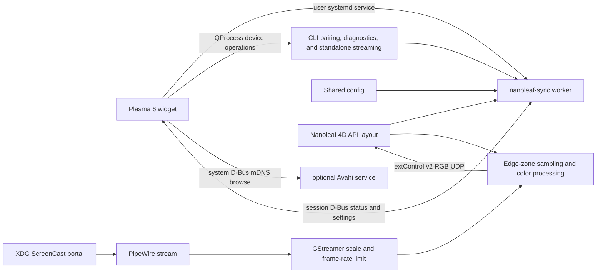

# Development

## Architecture



The worker discovers panel IDs and layout from the controller. The 34-segment path uses the controller's `positionData`; the 40-segment NL69 path uses calibrated perimeter geometry and dedicated corner zones; other supported counts use the generic mapping. Screen zones are mapped to the controller's panel IDs before packets are sent.

## Source map

| Path | Responsibility |
|---|---|
| `nanoleaf-sync.cpp` | CLI, `--version`, Nanoleaf LAN API, config persistence, portal/PipeWire capture, sampling, extControl v2 UDP, worker D-Bus API, `--device-info`, and `--self-test`. |
| `src/plasma/backend.cpp` | QML extension plugin; shared settings, worker status, user systemd unit, Avahi D-Bus discovery, CLI pairing/device details, and local credential removal. |
| `share/plasma/io.github.avitretiak.Wayleaf4D/` | Plasma applet metadata, QML UI, and ambient-light icon. |
| `share/plasma/io.github.avitretiak.Wayleaf4D/contents/ui/Nanoleaf/qmldir` | Declares the `Nanoleaf` QML module. |
| `share/systemd/user/nanoleaf-sync.service` | User service started and stopped by the applet. |
| `share/applications/io.github.avitretiak.Wayleaf4D.desktop` | Hidden desktop identity used when registering the app with the portal. |
| `docs/USAGE.md` | End-user setup, operation, settings, diagnostics, and removal. |

The QML plugin is built at `build/libnanoleafbackend.so` and installed separately into the applet's `contents/ui/Nanoleaf/` directory by the Makefile. Use `make install-user` to install or update the project. Upgrading only the Plasma package with `kpackagetool6` can remove that separately installed binary and produce `module "Nanoleaf" plugin "nanoleafbackend" not found`.

## Build dependencies

Use a C++17 compiler, GNU Make, `pkg-config`, Qt's `moc`, and development packages exposing these pkg-config modules:

- `gio-2.0`
- `gstreamer-app-1.0`
- `gstreamer-video-1.0`
- `json-glib-1.0`
- `libcurl`
- `Qt6Core`, `Qt6Qml`, and `Qt6DBus`

Runtime capture also needs a Wayland session, an XDG Desktop Portal ScreenCast implementation, PipeWire, and the GStreamer PipeWire source plus video-processing plugins. The Plasma applet requires Plasma 6 and a systemd user manager. Optional discovery uses the system Avahi D-Bus service; without it, enter the controller IPv4 address manually. The Makefile locates `moc` using `pkg-config --variable=libexecdir Qt6Core`; override `QT_LIBEXECDIR` or `MOC` if the local Qt installation places it elsewhere.

## Build and install

```sh
make
make install-user
```

`make` builds the worker and QML plugin under `build/`. `make install-user` installs under `~/.local/`, installs the user service under `$XDG_CONFIG_HOME/systemd/user/`, then runs `systemctl --user daemon-reload`. It does not enable, start, stop, or restart the worker. It does not overwrite the user's Nanoleaf config. `make clean` removes build outputs and old root-level artifacts from previous Makefile versions.

After changing QML or applet metadata, Plasma must reload the applet to read the new files. Log out and back in, or restart the Plasma shell on sessions providing `plasma-plasmashell.service`:

```sh
systemctl --user restart plasma-plasmashell.service
```

This restarts the desktop shell, not `nanoleaf-sync.service`.

## Verification

Run the device-independent checks from the repository root:

```sh
make
./build/nanoleaf-sync --self-test
./build/nanoleaf-sync --help
./build/nanoleaf-sync --version
```

`--self-test` uses temporary config data and loopback UDP. It checks settings and argument bounds, sampling, 34/40-segment alignment, and packet lengths; it does not prove portal access or controller behavior.

For a manual capture check, `./build/nanoleaf-sync --capture-test` exercises the portal/PipeWire stream without controller credentials or UDP streaming; it may prompt for screen-capture permission and saves the portal restore token. `./build/nanoleaf-sync --capture-debug` requires saved controller credentials and a portal selection; for ten seconds it prints timing and per-zone target/output RGB values, but sends no UDP frames and saves no screen images or settings. Review its output before sharing because sampled colors reflect the screen.

Before publishing a release, verify a fresh Plasma 6 Wayland install and real Nanoleaf streaming. The local self-test does not cover portal consent/restore or controller behavior.

## Shared-setting contract

The worker `Config`, the QML backend defaults and normalizer, the visible controls, and the settings table in `docs/USAGE.md` describe one shared JSON schema. When changing a setting, update all of them together and keep ranges/defaults aligned. Live changes cross the session D-Bus interface; the worker saves accepted settings to the shared config file.
